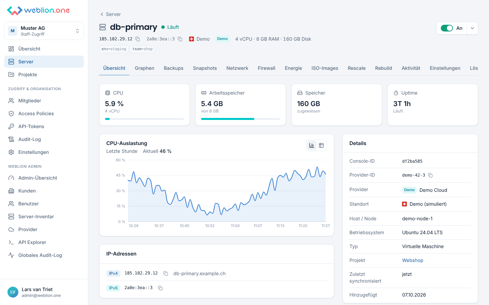
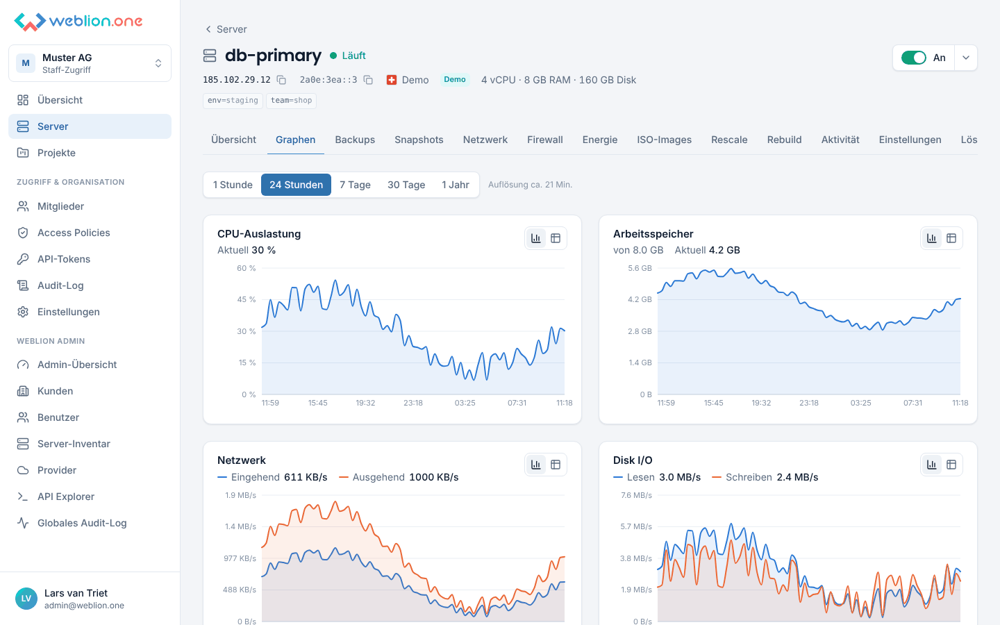
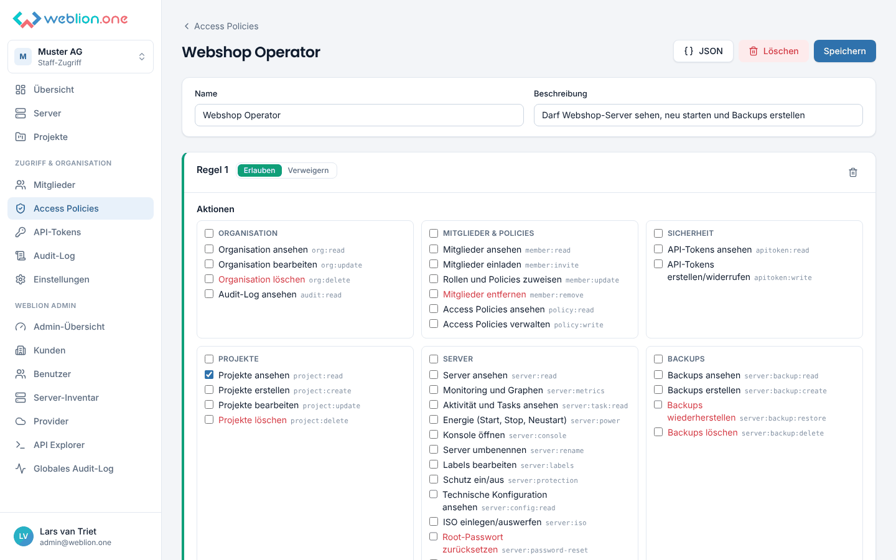
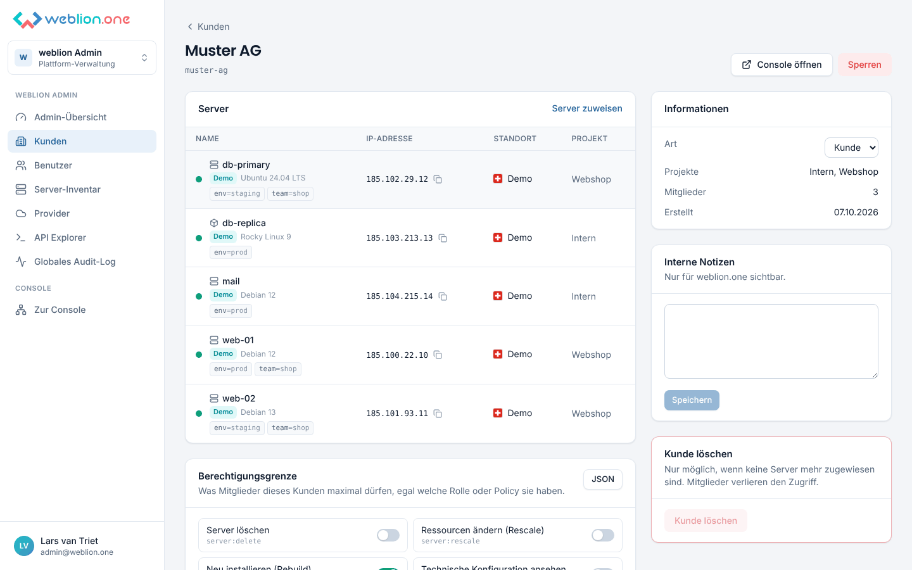
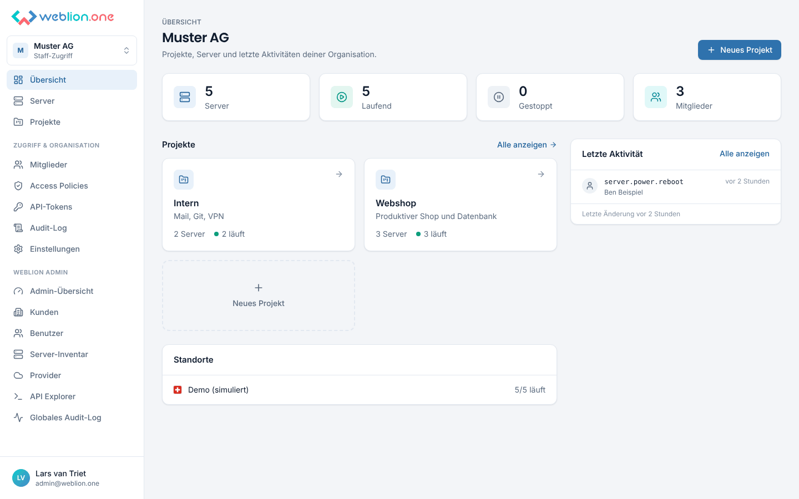
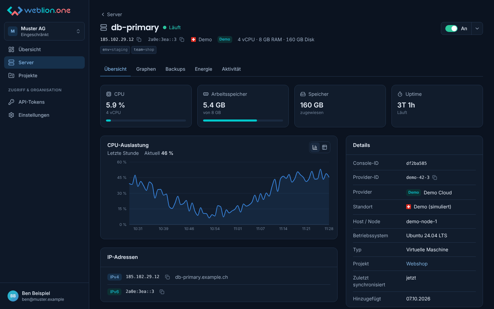
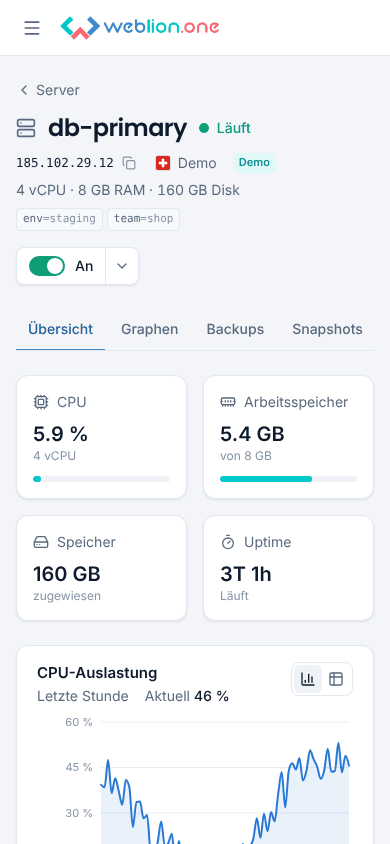
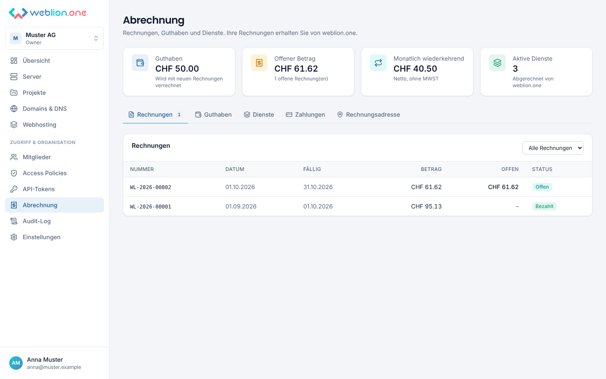
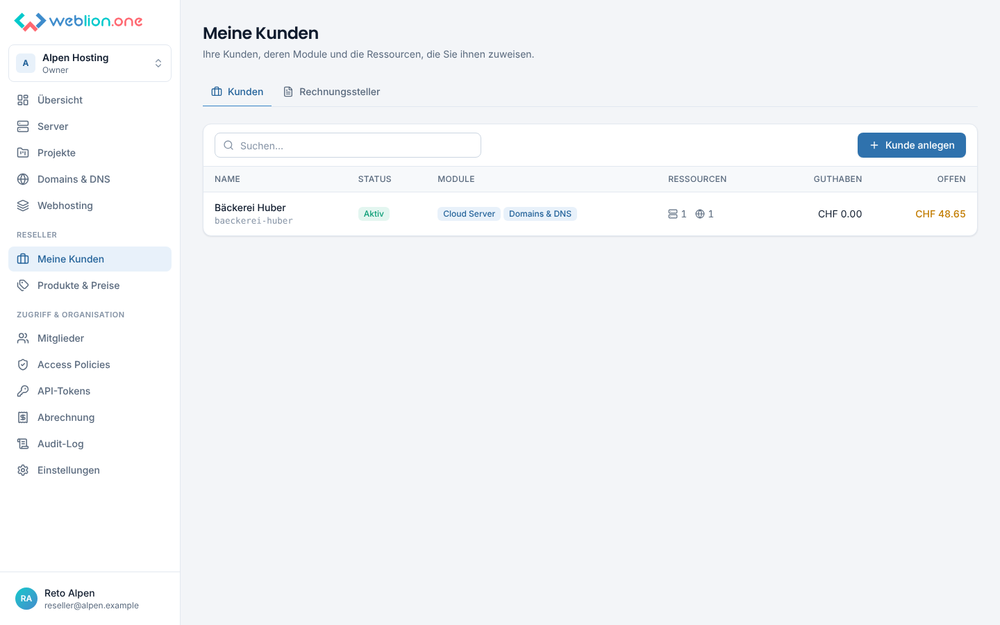
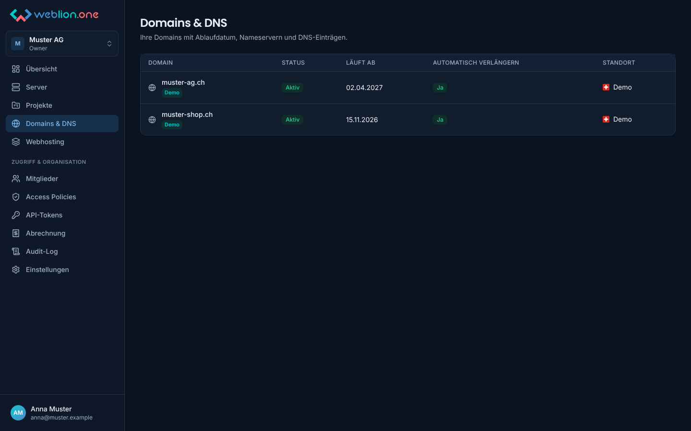

# weblion.one Console

Kunden- und Admin-Panel von weblion.one. Ein Panel für Cloud-Server im Rechenzentrum in
Deutschland (24fire), in der Hetzner Cloud (DE, FI, USA, SG) und auf eigener
Proxmox-Infrastruktur in der Schweiz, dazu Domains mit DNS (24fire und Joker.com), DNS-Zonen und
CDN bei Cloudflare, Websites auf eigenen CloudPanel-Servern und Webspaces bei 24fire,
Cloud-Speicher auf der eigenen Nextcloud, E-Mail auf eigenen Mailcow-Servern, Telefonanlagen mit
3CX, Streaming auf eigenen Jellyfin-Servern, Monitoring mit Uptime Kuma, Abrechnung mit
QR-Rechnung, Stripe/TWINT und Zoho Books, ein Reseller-Modell sowie Rollen, Access Policies und
Audit-Log. Dazu KI-Funktionen mit Claude, die weblion.one für jeden Kunden einzeln einschaltet.
Die Console gibt es auf Deutsch, Englisch, Französisch, Italienisch und Niederländisch; jede Person
wählt ihre Sprache im Profil, Rechnungen gehen in der Sprache des Kunden. Inspiriert von der Hetzner
Cloud Console.



## Was drin ist

**Für Kunden**
- Projekte und Server in einer Übersicht, Standort (Land und Stadt pro Server) und Provider auf
  einen Blick
- Server-Detail mit Tabs: Übersicht, Graphen (CPU, RAM, Netzwerk, Disk I/O, Ping), Backups,
  Snapshots, Netzwerk (rDNS, DDoS), Firewall, Energie, ISO-Images, Rescale (freie Werte oder
  feste Server-Typen wie bei Hetzner), Rebuild, Aktivität, Einstellungen (Name, Labels, Schutz,
  Projekt, Root-Passwort), Löschen. Jeder Tab erscheint nur, wenn der Provider die Funktion
  anbietet
- Browser-Konsole (noVNC) über eine Websocket-Bridge, ohne dass der Browser Provider-Zugangsdaten sieht
- Domains & DNS (24fire, Joker.com, Cloudflare): DNS-Einträge bearbeiten (bei Joker.com mit TTL,
  Weiterleitungen und E-Mail-Weiterleitung, bei Cloudflare mit Proxy und automatischer TTL),
  Nameserver ändern (Joker.com, 24fire), Transfersperre und Auth-Code für Transfers (Joker.com).
  Registrierung und Cloudflare-Zone derselben Domain sind verknüpft, wartende Zonen zeigen die
  Nameserver zum Eintragen
- CDN (Cloudflare): SSL/TLS-Modus, Always Use HTTPS, Entwicklungsmodus und Cache leeren, auch per
  API-Token nach einem Deployment
- E-Mail (Mailcow): Postfächer im gebuchten Rahmen anlegen (Passwort erzeugt und einmal angezeigt
  oder selbst gewählt), Grösse, Name und Status ändern, Weiterleitungen inklusive Catch-all,
  Einstellungen für Mailprogramme und Webmail, DNS-Einträge (MX, SPF, DKIM, DMARC, Autodiscover)
  prüfen, DKIM-Schlüssel erzeugen und fehlende Einträge mit einem Klick eintragen, wenn die Domain
  in der Console liegt
- Websites (CloudPanel): im gebuchten Kontingent selbst anlegen, als PHP-Anwendung (Generic,
  WordPress, WooCommerce), statische Website oder, wo freigegeben, Node.js. Zugang per SFTP/SSH,
  MySQL-Datenbanken, Passwörter erzeugt und einmal angezeigt oder selbst gewählt, neu setzen,
  Let's-Encrypt-Zertifikat mit vorheriger DNS-Prüfung, Belegung von Dateien und Datenbanken,
  Löschen mit Bestätigung
- Webhosting (24fire/Plesk): Ressourcen, Anmeldung bei Plesk über einen einmaligen Link (ohne
  Passwort), Hinweise für Mail-Programme, wenn die Adresse des Panels bekannt ist
- Cloud-Speicher (Nextcloud): Konten für das Team im gebuchten Kontingent selbst anlegen, jedes
  mit eigenem Kontingent. Name, E-Mail und Kontingent ändern, deaktivieren, Passwort neu setzen
  (einmal angezeigt) oder Einladung per E-Mail, Belegung pro Konto, Löschen mit Bestätigung
- Telefonie (3CX): die eigenen Telefonanlagen (auch mehrere, z.B. pro Standort) mit Lizenz,
  Gesprächen, Leitungen und Zustand. Benutzer und Nebenstellen anlegen (nächste freie Nummer oder
  eigene), ändern und löschen, Willkommens-E-Mail der Anlage senden, Mitglieder von Ringgruppen
  ändern, Leitungen ansehen, Link zum 3CX-Webclient
- Streaming (Jellyfin): Zugänge für Personen oder Geräte im gebuchten Kontingent selbst anlegen,
  mit erzeugtem (einmal angezeigt, fernbedienungsfreundlich) oder eigenem Passwort, deaktivieren,
  Passwort neu setzen, löschen. Jeder Zugang bekommt genau die Bibliotheken, Streams, Downloads und
  Bitrate des Kontingents. Anmeldehilfe mit Server-Adresse, Apps und Quick Connect für den
  Fernseher. Was jemand anschaut, zeigt die Console nicht. Mit dem Add-on "Anfragen" (Seerr)
  wünschen sich die Zugänge Filme und Serien, die Console zeigt pro Zugang nur Zahlen (offen,
  genehmigt, verfügbar, genutztes Kontingent)
- Monitoring (Uptime Kuma): Status, Uptime über 24 Stunden und 30 Tage, Antwortzeit und Ablauf der
  Zertifikate der eigenen Monitore, Verlauf als Diagramm, Link zur Statusseite. Im Kontingent eigene
  Monitore anlegen (HTTP(S), Keyword, Ping, Port, nur öffentliche Ziele), ändern, pausieren,
  löschen. Monitore erscheinen auch auf den Seiten der Server und Domains, die sie prüfen
- Abrechnung: Rechnungen als PDF mit QR-Rechnung, Guthaben, Dienste, online bezahlen mit
  Karte oder TWINT, Rechnungsadresse und Sprache für Rechnungen
- KI (Claude), wenn weblion.one oder der Reseller sie für den Kunden eingeschaltet hat: ein
  Assistent, der Fragen zu den eigenen Servern, Domains, Websites, E-Mail, Monitoren und Rechnungen
  beantwortet (er liest nur, mit den Rechten der Person), Erklärungen zu Fehlern und Einträgen, eine
  Prüfung der DNS- und E-Mail-Einträge mit Vorschlägen, die das normale Formular vorausgefüllt
  öffnen, Zusammenfassungen des Audit-Logs und die Analyse eines Servers (Graphen, Monitoring,
  letzte Aktionen). Die Rollen Eingeschränkt und Buchhaltung bekommen sie nur über eine Policy. Der
  Kunde kann die KI unter Einstellungen > KI-Funktionen jederzeit ablehnen, dann gehen auch für
  Mitarbeitende von weblion.one keine Daten mehr an Claude
- Nur freigeschaltete Module sind sichtbar (z.B. DNS erst, wenn es aktiviert ist)
- Mitglieder einladen (mit E-Mail), Rollen (Owner, Admin, Member, Eingeschränkt, Nur lesen,
  Buchhaltung)
- Access Policies im IAM-Stil: Aktionen erlauben/verweigern pro Projekt, Server oder Label
- API-Tokens (Lesen / Lesen & Schreiben) für Automatisierung
- Audit-Log, 2FA (TOTP), aktive Sitzungen
- Deutsch, Englisch, Französisch, Italienisch und Niederländisch (Sprache pro Person im Profil),
  helles und dunkles Theme, mobil nutzbar

**Für weblion.one (Admin-Bereich)**
- Plattform-Übersicht mit Provider-Status und fehlgeschlagenen Aktionen
- Kunden und Reseller anlegen (mit Einladung für den Owner), sperren, Module freischalten,
  Berechtigungsgrenze pro Kunde
- Abrechnung: Rechnungen erstellen und abschliessen, Guthaben buchen, Dienste freischalten,
  Produkte und Preise (Name und Beschreibung in fünf Sprachen, auf Wunsch von der KI geschrieben
  oder übersetzt), wiederkehrende Abrechnung, Übersicht über offene und überfällige Beträge
- Domains (24fire, Joker.com), DNS-Zonen (Cloudflare), Webspaces (24fire) und Websites
  (CloudPanel) Kunden zuweisen.
  Eine neue Cloudflare-Zone geht beim ersten Sync an den Kunden der gleichnamigen Registrierung,
  wenn dieser eindeutig ist
- DNS einer Domain zu Cloudflare umziehen: Zone anlegen, Einträge vom Registrar kopieren, danach
  die Nameserver umstellen, jeder Schritt im Audit-Log
- E-Mail: Mail-Domains auf beliebig vielen Mailcow-Instanzen anlegen, mit Limits (Postfächer,
  Weiterleitungen, Speicher, Grösse pro Postfach, Versandlimit) und DKIM-Schlüssel, Limits ändern,
  Kunden zuweisen, leere Domains löschen. Bestehende Domains kommen mit dem Sync
- Cloud-Speicher: Kontingent pro Kunde auf einer Nextcloud-Instanz (Speicher und Zahl der
  Konten), alle Cloud-Konten mit Belegung, bestehende Nextcloud-Benutzer übernehmen und Kunden
  zuweisen
- Websites: beliebig viele CloudPanel-Server anbinden (SSH-Schlüssel erzeugen, Host-Schlüssel
  gepinnt), Website-Kontingent pro Kunde (Server, Websites, Datenbanken, erlaubte Arten),
  Websites für Kunden anlegen, bestehende Sites eines Servers übernehmen und aus der Console
  entfernen. Auf dem Server arbeitet ein kleiner Root-Wrapper (`deploy/cloudpanel-agent`), der nur
  Sites ändert, die die Console verwaltet
- Telefonie: beliebig viele 3CX-Telefonanlagen anbinden (eine pro Verbindung, über die XAPI mit
  einem eigenen API-Client) und Kunden zuweisen, alle Anlagen mit Zustand, Lizenz und Benutzern in
  einer Liste
- Streaming: beliebig viele Jellyfin-Instanzen (gemeinsam oder dediziert), Kontingent pro Kunde
  (Zugänge, Bibliotheken, Streams, Downloads, Bitrate unterwegs) mit Kontingent-Code für die
  Login-Namen, bestehende Jellyfin-Benutzer übernehmen und zuweisen, Richtlinie anwenden. Der Sync
  stellt Rechte wieder her, die jemand in Jellyfin geändert hat. Optional Anfragen über Seerr: pro
  Instanz prüfen (mit "Empfohlene Einstellungen anwenden") und einschalten, pro Kunde als Add-on mit
  Filmen, Serien und Grenzen pro Zugang, auch für Reseller
- Monitoring: beliebig viele Instanzen von Uptime Kuma, Monitore Kunden zuweisen (auch alle einer
  Instanz auf einmal), Instanzen für die Verwaltung anmelden (nur das Sitzungstoken wird
  gespeichert), Kontingente für eigene Monitore und verknüpfte Statusseiten pro Kunde
- Domains verlängern und die automatische Verlängerung schalten (Joker.com, nur mit Login)
- Einstellungen: SMTP, Rechnungssteller (Adresse, IBAN, MWST, Nummernkreis), Status von
  Stripe und Zoho Books, Mail-Log
- Benutzerverwaltung inkl. Plattform-Rollen (Superadmin, Support)
- KI (Admin > KI): Schlüssel, Modell, Funktionen, Budget und Limits, Nutzung und Kosten pro
  Funktion, Modell und Kunde, Fehler, Datenschutzhinweis. Pro Kunde einschalten, nachdem der Kunde
  zugestimmt hat (im Audit-Log festgehalten). Erklärungen und Zusammenfassungen auch im
  Admin-Bereich, siehe [docs/ai.md](docs/ai.md)
- Übersetzungen (Admin > Übersetzungen): alle Texte in fünf Sprachen ansehen und ändern (gilt
  sofort, ohne Deploy), fehlende und veraltete finden, mit KI übersetzen (Mass Translate mit
  Schätzung der Kosten), Glossar, Stilhinweise, Import und Export, siehe
  [docs/i18n.md](docs/i18n.md)
- Server-Inventar: neue Server werden automatisch synchronisiert und Kunden zugewiesen
- Provider verwalten, Verbindung testen, Infrastruktur (Nodes, Storages) ansehen
- Server bei Proxmox aus Templates erstellen, bei Hetzner Cloud mit Server-Typ, Standort und
  Image (Einkaufspreise nur für weblion.one sichtbar)
- API Explorer: Rohzugriff auf die 24fire- (Customer REST API v1), Proxmox-, Hetzner-Cloud-,
  Joker.com- (DMAPI) und Cloudflare-API, die OCS-API von Nextcloud, die API von Mailcow, die XAPI
  von 3CX und die API von Jellyfin für alles ohne eigenen Button (ohne Pfade, die Zugangsdaten
  herausgeben), bei Uptime Kuma `/metrics`, die Statusseiten und eine feste Liste von
  Socket-Events, bei CloudPanel nur lesend (Server, verwaltete und nicht verwaltete Sites)

**Für Reseller**
- Eigene Kunden anlegen und sperren, Module freischalten (bis zum eigenen Umfang)
- Im Panel der Kunden arbeiten, Server, Domains, DNS-Zonen, Webspaces, Websites, Mail-Domains,
  Telefonanlagen und Monitore zuteilen
- Kunden einen Teil des eigenen Kontingents für Cloud-Speicher, Websites, Streaming und Monitoring
  geben
- Eigene Produkte und Preise, Rechnungen mit eigenem Briefkopf und Nummernkreis, Guthaben
- KI für die eigenen Kunden einschalten, nachdem sie zugestimmt haben (nur, solange sie für den
  Reseller selbst an ist), Produkttexte mit KI schreiben und übersetzen

| Graphen | Access Policies | Kunde im Admin-Bereich |
|---|---|---|
|  |  |  |
| **Dashboard** | **Dunkel, eingeschränkter Benutzer** | **Mobil** |
|  |  |  |
| **Abrechnung** | **Reseller: eigene Kunden** | **Domains & DNS (dunkel)** |
|  |  |  |

## Stand

- Gegen echte 24fire-, Proxmox-, Hetzner-, Joker.com-, Cloudflare-, Nextcloud-, Mailcow-,
  CloudPanel-, 3CX-, Jellyfin-, Uptime-Kuma-, Stripe- und Zoho-Systeme ist die Console noch **nicht
  live getestet**: Die Build-Umgebung hatte keinen Netzzugriff darauf. Alle Anbindungen sind gegen
  Mock-Server getestet, die die dokumentierten Antworten nachbilden. Die 24fire-Endpunkte folgen
  der OpenAPI-Spezifikation der Customer REST API v1 (wo sie nur Beispiele statt Antworten zeigt,
  liest die Console tolerant und meldet unbekannte Formen), die Proxmox-Aufrufe der API-Referenz,
  die Hetzner-Aufrufe der API-Doku und dem offiziellen Go-Client hcloud-go, die Joker-Requests der
  DMAPI-Spezifikation, die Cloudflare-Aufrufe der OpenAPI-Spezifikation von Cloudflare, die
  Nextcloud-Aufrufe der Doku der Provisioning API und dem Quellcode von Nextcloud, die
  Mailcow-Aufrufe dem Quellcode von Mailcow (`json_api.php`), die 3CX-Aufrufe der offiziellen
  OpenAPI-Beschreibung der XAPI (3CX 20.0.10.1479) und dem Tutorial-Repository von 3CX, die
  Jellyfin-Aufrufe dem Quellcode von Jellyfin 10.11.11 (und 10.10.7), die Uptime-Kuma-Aufrufe dem
  Quellcode von Uptime Kuma 2.5.6 (die Socket.IO-Events der Weboberfläche sind dort nicht als API
  dokumentiert). Der CloudPanel-Agent folgt der Doku von CloudPanel, seinem Issue-Tracker und
  Community-Code, der `clpctl` aufruft, und ist mit Python-Tests gegen nachgebaute Werkzeuge
  geprüft. Was bei 24fire, Joker.com, Cloudflare, Nextcloud, Mailcow, CloudPanel, 3CX, Uptime Kuma
  und Jellyfin noch zu prüfen ist, steht in [docs/providers.md](docs/providers.md) jeweils unter
  "Offene Punkte", für 24fire mit einer Checkliste für den
  [Live-Test](docs/providers.md#live-test-der-api-v1).
- Hetzner Cloud: Firewalls, Volumes, Load Balancer, Floating/Primary IPs, Storage Boxes,
  DNS-Zonen und dedizierte Server (Robot) sind noch nicht angebunden, siehe
  [docs/providers.md](docs/providers.md#hetzner-cloud).
- Webspaces kann die 24fire-API nicht anlegen: Neue Webspaces werden im 24fire-Panel bestellt und
  erscheinen nach dem nächsten Sync in der Console, wo sie einem Kunden zugewiesen werden. Den
  Auth-Code für den Transfer einer 24fire-Domain gibt die API nicht heraus, den gibt es nur im
  24fire-Panel.
- 24fire nutzt die Customer REST API v1 mit einem Personal Access Token. Keys der alten API v2
  funktionieren nicht mehr, der Umstieg steht in
  [docs/providers.md](docs/providers.md#umstieg-von-api-v2).
- Domains registrieren und zu Joker.com transferieren geht noch im Joker-Panel. Die Domains
  erscheinen danach ebenso beim nächsten Sync.
- Cloud-Speicher: Die Nextcloud-Instanz selbst betreibt weblion.one (z.B. Nextcloud AIO auf einer
  VM), die Console verwaltet nur ihre Benutzer. Sperren eines Kunden und Kündigen eines Dienstes
  deaktivieren seine Nextcloud-Konten nicht, das geht von Hand. Eine Abrechnung nach belegtem
  Speicher gibt es nicht, siehe [docs/providers.md](docs/providers.md#nextcloud-cloud-speicher).
- Cloudflare: Zonen legt die Console nur beim DNS-Umzug an, sonst im Cloudflare-Dashboard, sie
  erscheinen dann beim nächsten Sync. Zonen löschen, Page Rules, Cache-Regeln und DNSSEC gehen
  weiterhin im Dashboard, siehe [docs/providers.md](docs/providers.md#cloudflare-dns-und-cdn).
- E-Mail: Die Mailcow-Server selbst betreibt weblion.one, die Console verwaltet deren Domains,
  Postfächer und Weiterleitungen. Mail-Domains legt nur weblion.one an. Sperren eines Kunden stellt
  seine E-Mail nicht ab, und ein Dienst lässt sich noch nicht mit einer Mail-Domain verknüpfen,
  siehe [docs/providers.md](docs/providers.md#mailcow-e-mail).
- Websites: Die CloudPanel-Server betreibt weblion.one, am besten getrennt vom Server der Console,
  mit dem Agent aus `deploy/cloudpanel-agent` auf jedem Server. Es gibt kein Speicherlimit (nur die
  Anzeige der Belegung), keine E-Mail auf den Websites und keine Wiederherstellung aus der Console.
  Sperren eines Kunden legt seine Websites nicht still. WordPress mit einem Klick, das Eintragen
  fehlender DNS-Einträge und die Kopplung an die Abrechnung folgen in einer zweiten Stufe, siehe
  [docs/providers.md](docs/providers.md#cloudpanel-websites) und die
  [Roadmap](docs/roadmap.md#websites-cloudpanel).
- Telefonie: Die 3CX-Telefonanlagen betreibt weblion.one, die XAPI braucht eine
  Enterprise-Lizenz und einen eigenen API-Client pro Anlage, Lizenzen laufen ausserhalb der Console.
  Weil 3CX pro API-Client nur ein Token zulässt, läuft die Console mit einem API-Prozess.
  Abteilungen, Warteschlangen, Weiterleitungen und Durchwahlen gehen weiterhin im 3CX-Webclient.
  Sperren eines Kunden stellt seine Anlage nicht ab, und eine Anlage lässt sich noch nicht mit
  einem Dienst verknüpfen, siehe [docs/providers.md](docs/providers.md#3cx-telefonie).
- Streaming: Die Jellyfin-Server und ihre Inhalte betreibt weblion.one, die Console verwaltet nur
  die Zugänge und ihre Rechte. Sperren eines Kunden deaktiviert seine Zugänge nicht, und eine
  Abrechnung pro Zugang gibt es nicht, siehe
  [docs/providers.md](docs/providers.md#jellyfin-streaming).
- Monitoring: Lesen geht mit jeder Instanz von Uptime Kuma 2.x über `/metrics`. Eigene Monitore
  der Kunden brauchen die Anmeldung für die Verwaltung, die über die nicht dokumentierten
  Socket-Events der Weboberfläche läuft und mit einem Update von Uptime Kuma brechen kann (das
  Lesen nicht). Bei einem Ausfall benachrichtigt die Console keine Kunden, Statusseiten legt
  weblion.one in Uptime Kuma an, siehe
  [docs/providers.md](docs/providers.md#uptime-kuma-monitoring).
- KI: Gegen die echte Claude API ist die Console noch nicht live getestet. Die Tests laufen gegen
  eine nachgebaute API (`apps/api/test/claude-mock.ts`), die Anfragen folgen den Typen des SDK
  `@anthropic-ai/sdk` 1.3.0. Die KI liest nur, Aktionen wie ein Postfach oder einen Monitor
  vorausgefüllt anlegen folgen später, siehe die [Roadmap](docs/roadmap.md#ki-claude).

## Schnellstart (Entwicklung)

Voraussetzungen: Node 22, pnpm 10, Postgres 16.

```bash
pnpm install
cp .env.example .env          # ENCRYPTION_KEY, BOOTSTRAP_ADMIN_* und Provider-Zugangsdaten setzen
pnpm db:migrate
pnpm dev                      # API auf :3000, Web auf :5173
```

Mit Demo-Daten (simulierter Provider mit simulierter Nextcloud, simuliertem Mailcow, drei
simulierten 3CX-Anlagen, simuliertem Jellyfin und simuliertem Uptime Kuma, Beispielkunden, ohne
echte Server):

```bash
ENABLE_DEMO_PROVIDER=true pnpm db:seed
# dazu ein simuliertes Cloudflare-Konto (Zonen, Proxy, CDN, DNS-Umzug):
ENABLE_DEMO_PROVIDER=true ENABLE_DEMO_CLOUDFLARE=true pnpm db:seed
# dazu ein simulierter CloudPanel-Server mit Websites und Kontingenten:
ENABLE_DEMO_PROVIDER=true ENABLE_DEMO_CLOUDPANEL=true pnpm db:seed
```

Login danach mit `BOOTSTRAP_ADMIN_EMAIL` / `BOOTSTRAP_ADMIN_PASSWORD` aus der `.env`.
Demo-Benutzer, Passwort `demo-password-123`:

| | |
|---|---|
| `anna@muster.example` | Owner Muster AG (Server, Domains, Webhosting, Cloud-Speicher, E-Mail, Telefonie, Streaming, Monitoring, Rechnungen, mit `ENABLE_DEMO_CLOUDPANEL` drei Websites) |
| `ben@muster.example` | eingeschränkt, nur Webshop-Projekt |
| `carla@muster.example` | nur lesen |
| `dev@beispiel.example` | Owner Beispiel GmbH (mit `ENABLE_DEMO_CLOUDFLARE` eine wartende Cloudflare-Zone) |
| `reseller@alpen.example` | Owner des Resellers Alpen Hosting |
| `huber@baeckerei.example` | Owner von Bäckerei Huber (Kunde von Alpen Hosting) |

## Zugangsdaten (24fire, Proxmox, Hetzner Cloud, Joker.com, Cloudflare, Nextcloud, Mailcow, CloudPanel, Jellyfin, Uptime Kuma, 3CX)

Zugangsdaten gehören **nicht** ins Git-Repo, auch nicht in ein privates. Sie kommen aus
Umgebungsvariablen (`.env` lokal, Secrets im Deployment) und werden beim Start verschlüsselt
(AES-256-GCM mit `ENCRYPTION_KEY`) in der Datenbank abgelegt:

| Variable | Bedeutung |
|---|---|
| `FIRE24_API_KEY` | Personal Access Token der 24fire Customer REST API v1 (`123\|cra_…`) aus den 24fire Kontoeinstellungen, in einfachen Anführungszeichen. Scopes und Produktfreigabe: [docs/providers.md](docs/providers.md#scopes) |
| `FIRE24_BASE_URL` | optional, Standard `https://api.24fire.de` (ohne `/v1`) |
| `PROXMOX_URL` | z.B. `https://pve01-zrh.weblion.cloud:2096` |
| `PROXMOX_TOKEN_ID` | `user@realm!tokenid` |
| `PROXMOX_TOKEN_SECRET` | Token-Secret (UUID) |
| `HETZNER_API_TOKEN` | API-Token eines Hetzner-Cloud-Projekts ("Lesen & Schreiben"), eine Verbindung pro Projekt |
| `HETZNER_BASE_URL` | optional, Standard `https://api.hetzner.cloud/v1` |
| `JOKER_API_KEY` | API-Key des Reseller-Kontos bei Joker.com (alternativ `JOKER_USERNAME` und `JOKER_PASSWORD`) |
| `JOKER_BASE_URL` | Standard `https://dmapi.joker.com/request`, Testsystem `https://dmapi.ote.joker.com/request` |
| `NEXTCLOUD_URL` | Adresse der eigenen Nextcloud-Instanz, z.B. `https://cloud.weblion.one` |
| `NEXTCLOUD_USER` | Admin-Konto der Console in Nextcloud (Mitglied der Gruppe `admin`) |
| `NEXTCLOUD_APP_PASSWORD` | App-Passwort dieses Kontos (in Anführungszeichen) |
| `CLOUDFLARE_API_TOKEN` | API-Token (kein Global API Key) mit Zone:Edit, DNS:Edit, Zone Settings:Edit und Cache Purge:Purge für alle Zonen des Kontos |
| `CLOUDFLARE_ACCOUNT_ID` | optional, Konto-ID (32 Zeichen), nötig zum Anlegen von Zonen (DNS-Umzug zu Cloudflare) |
| `MAILCOW_URL` | Adresse der eigenen Mailcow-Instanz, z.B. `https://mail.weblion.one` |
| `MAILCOW_API_KEY` | API-Key mit Lese- und Schreibzugriff (in Anführungszeichen), die IPs der Console in seiner Allow-List |
| `MAILCOW_MAIL_HOST` | optional, öffentlicher Name des Mailservers (MX, IMAP, SMTP, Webmail), Standard: Host aus `MAILCOW_URL` |
| `CLOUDPANEL_HOST` | SSH-Host des eigenen CloudPanel-Servers, z.B. `web1.weblion.cloud` (Port `CLOUDPANEL_PORT`, Benutzer `CLOUDPANEL_USER`, Standard `22` und `weblion-agent`) |
| `CLOUDPANEL_PRIVATE_KEY_FILE` | Datei mit dem privaten ed25519-Schlüssel der Console (alternativ `CLOUDPANEL_PRIVATE_KEY` inline) |
| `CLOUDPANEL_HOST_KEY` | Fingerabdruck des Host-Schlüssels, `SHA256:...` (gibt `install.sh` aus) |
| `CLOUDPANEL_ACCESS_HOST` | optional, Host für SFTP/SSH der Kunden, Standard: `CLOUDPANEL_HOST` |
| `JELLYFIN_URL` | Adresse der eigenen Jellyfin-Instanz (10.10 oder neuer), wie die Kunden sie in den Apps eingeben, mit Basis-Pfad, falls gesetzt |
| `JELLYFIN_API_KEY` | API-Schlüssel aus dem Jellyfin-Dashboard (32 Zeichen, volle Administratorrechte, nur für die Console) |
| `UPTIMEKUMA_URL` | Adresse der eigenen Instanz von Uptime Kuma 2.x, ohne Pfad, z.B. `https://status.weblion.one` |
| `UPTIMEKUMA_API_KEY` | API-Schlüssel aus Uptime Kuma (`uk…`, ohne Ablaufdatum). Der erste Schlüssel stellt `/metrics` auf Schlüssel um |
| `UPTIMEKUMA_SESSION_TOKEN` | optional, Sitzungstoken für die Verwaltung (eigene Monitore der Kunden), erzeugt mit `pnpm --filter @weblion/api kuma:token` |
| `ENCRYPTION_KEY` | `openssl rand -base64 32`, gut aufbewahren |

Weitere Provider (z.B. weitere Hetzner-Projekte, Cloudflare-Konten, Nextcloud-, Mailcow-, Jellyfin-
oder Uptime-Kuma-Instanzen, CloudPanel-Server) lassen sich im Admin-Bereich hinzufügen. 3CX-Anlagen
gibt es nur dort: Client-ID und API-Schlüssel eines eigenen API-Clients pro Anlage. Details,
Hinweise zum 24fire-Token (Scopes), zum Proxmox- und Hetzner-Token, zum Joker-Reseller-Konto, zum
Cloudflare-Token, zum Nextcloud-Admin-Konto, zum Mailcow-API-Key (Allow-List, Netfilter), zum Agent auf
CloudPanel-Servern, zum API-Client von 3CX, zum Schlüssel von Jellyfin und zur Anmeldung von Uptime
Kuma für die Verwaltung in [docs/providers.md](docs/providers.md) und
[deploy/cloudpanel-agent/README.md](deploy/cloudpanel-agent/README.md).

Für E-Mail (SMTP), Stripe/TWINT, Zoho Books und die KI kommen weitere Variablen dazu, alle in
`.env.example` beschrieben. Den Schlüssel für Claude (`ANTHROPIC_API_KEY`) nimmt die Console
direkt aus der Umgebung und legt ihn nicht in der Datenbank ab, siehe [KI (Claude)](#ki-claude).
SMTP lässt sich statt in der `.env` auch im Admin-Bereich eintragen (verschlüsselt gespeichert).
Einrichtung Schritt für Schritt in [docs/billing.md](docs/billing.md).

## KI (Claude)

Die Console nutzt Claude von Anthropic für sieben Funktionen: Assistent, Erklärungen, Prüfung von
DNS und E-Mail, Zusammenfassung des Audit-Logs, Analyse eines Servers, Produkttexte und
Übersetzungen. Die KI liest nur. Vorschläge (etwa ein DNS-Eintrag) öffnen das normale Formular,
gespeichert wird dort, mit der normalen Rechteprüfung.

- **Aus, bis jemand einschaltet:** Auf der Plattform schaltet ein Superadmin die KI unter Admin > KI
  ein und bestätigt dabei eine Checkliste (AGB und Auftragsverarbeitungsvertrag, Grundlage für die
  Übermittlung in die USA, Datenschutzhinweis, Ort des Workspace). Für jeden Kunden bleibt sie
  danach aus, bis weblion.one (Admin > Kunden) oder sein Reseller sie einschaltet, nachdem der Kunde
  zugestimmt hat. Das Audit-Log hält die Bestätigung fest. Der Kunde kann jederzeit ablehnen
  (Einstellungen > KI-Funktionen), das gilt auch für die Funktionen der Mitarbeitenden.
- **Schlüssel** aus der Claude Console unter Admin > KI speichern (verschlüsselt, danach nie mehr
  angezeigt) oder als `ANTHROPIC_API_KEY` setzen. Der gespeicherte hat Vorrang.
- **Modell und Kosten:** ein Modell für alle Funktionen, Standard Claude Opus 5.5 (USD 4 pro
  Million Tokens Eingabe, USD 20 Ausgabe), wählbar sind auch Claude Sonnet 5.5 und Claude Haiku
  5.5. Budget standardmässig USD 100 pro Monat, als harte Grenze, Warnung per E-Mail ab 80 Prozent.
- **Daten:** Fragen und Antworten speichert die Console nicht, nur Angaben zur Nutzung (400 Tage).
  Der Chat bleibt im Browser-Tab. Geheimnisse, die die Console erkennt, entfernt sie vor dem Senden.
- **Demo:** Ohne Schlüssel und mit `ENABLE_DEMO_PROVIDER=true` antworten Beispiele statt Claude.

Den Datenschutzhinweis (`ai.notice.text`) muss der Inhaber vor dem Einschalten in allen fünf
Sprachen prüfen, am besten mit juristischer Beratung. Er wird nie maschinell übersetzt. Alles
Weitere in [docs/ai.md](docs/ai.md).

| Variable | Bedeutung |
|---|---|
| `ANTHROPIC_API_KEY` | optional, API-Schlüssel aus der Claude Console (`sk-ant-…`, kein Admin-API-Schlüssel `sk-ant-admin-…`), in Anführungszeichen. Ein unter Admin > KI gespeicherter Schlüssel hat Vorrang |
| `ANTHROPIC_BASE_URL` | optional, Standard `https://api.anthropic.com` |
| `ANTHROPIC_MAX_RETRIES` | optional, Wiederholungen des SDK bei 408, 409, 429, 5xx und Verbindungsfehlern, 0 bis 5, Standard `2` |
| `AI_TURN_TIMEOUT_SECONDS` | optional, längste Dauer einer KI-Anfrage (eine Antwort im Chat oder ein Aufruf einer Funktion) in Sekunden, 30 bis 600, Standard `180` |
| `I18N_JOB_ENABLED` | optional, Standard `true`: dieser Prozess führt Mass Translate aus. Auf weiteren API-Prozessen `false` |
| `I18N_AI_CONCURRENCY` | optional, Pakete einer Übersetzung, die gleichzeitig an Claude gehen, 1 bis 4, Standard `2` |

## Produktion

```bash
cp .env.example .env    # NODE_ENV=production, APP_URL=https://cp.weblion.cloud, Secrets setzen
docker compose up -d --build
```

Ein Container liefert API und Web aus, davor ein Reverse Proxy mit TLS. Datenbank ist
PostgreSQL (nicht MySQL). Ein eigener Server ist nicht nötig: Die Console läuft auch auf
einem bestehenden CloudPanel-Server mit, mit oder ohne Docker.
Siehe [docs/deployment.md](docs/deployment.md).

## Projektstruktur

```
apps/api         Fastify API, Postgres (Drizzle), Provider-Adapter, Sync-Job
apps/web         React Console (Vite, Tailwind, TanStack Query)
packages/shared  Berechtigungen, Rollen, Policy-Engine und API-Typen (von beiden genutzt)
deploy/          Agent für CloudPanel-Server (cloudpanel-agent), Deploy auf CloudPanel (cloudpanel)
docs/            Architektur, Provider, Deployment, KI, Sprachen, Roadmap
```

| Befehl | |
|---|---|
| `pnpm dev` | API und Web im Watch-Modus |
| `pnpm test` | Unit- und Integrationstests (braucht Postgres, `TEST_DATABASE_URL`) |
| `pnpm typecheck` | TypeScript in allen Paketen |
| `pnpm build` | Produktions-Build |
| `pnpm db:generate` | Migration aus Schema-Änderungen erzeugen |
| `pnpm --filter @weblion/api i18n:report` | fehlende und veraltete Übersetzungen pro Sprache; `i18n:stamp` und `i18n:apply` siehe [docs/i18n.md](docs/i18n.md) |
| `python3 -I -m unittest discover -s deploy/cloudpanel-agent/tests -v` | Tests des CloudPanel-Agents (Python 3.9+, ohne root und Netz) |

## REST-API

Alles, was die Console kann, geht auch per API unter `/api/v1`, authentifiziert mit einem
API-Token aus der Console:

```bash
curl -H "Authorization: Bearer wlc_…" https://cp.weblion.cloud/api/v1/orgs/<org-id>/servers
curl -X POST -H "Authorization: Bearer wlc_…" -H "Content-Type: application/json" \
  -d '{"action":"reboot"}' https://cp.weblion.cloud/api/v1/servers/<server-id>/power
curl -H "Authorization: Bearer wlc_…" https://cp.weblion.cloud/api/v1/orgs/<org-id>/cloud
curl -H "Authorization: Bearer wlc_…" https://cp.weblion.cloud/api/v1/orgs/<org-id>/mail/domains
curl -H "Authorization: Bearer wlc_…" https://cp.weblion.cloud/api/v1/orgs/<org-id>/webspaces
curl -H "Authorization: Bearer wlc_…" https://cp.weblion.cloud/api/v1/orgs/<org-id>/phone-systems
curl -H "Authorization: Bearer wlc_…" https://cp.weblion.cloud/api/v1/orgs/<org-id>/monitoring
curl -X POST -H "Authorization: Bearer wlc_…" -H "Content-Type: application/json" \
  -d '{"everything":true}' https://cp.weblion.cloud/api/v1/domains/<domain-id>/cdn/purge
```

## Weiterlesen

- [docs/architecture.md](docs/architecture.md): Aufbau, Rechte-Modell, neue Provider anbinden
- [docs/billing.md](docs/billing.md): Abrechnung, Reseller, Module, Cloud-Speicher und E-Mail
  verkaufen, Stripe/TWINT, Zoho Books, E-Mail der Console
- [docs/providers.md](docs/providers.md): 24fire, Proxmox, Hetzner Cloud, Joker.com, Cloudflare,
  Nextcloud, Mailcow, CloudPanel, 3CX, Uptime Kuma und Jellyfin einrichten, Kosten, offene Punkte
- [deploy/cloudpanel-agent/README.md](deploy/cloudpanel-agent/README.md): der Agent auf den
  CloudPanel-Servern (installieren, Schutzliste, übernehmen, testen)
- [docs/ai.md](docs/ai.md): KI-Funktionen mit Claude, Schlüssel, Kosten, Schalter, vor dem
  Einschalten
- [docs/i18n.md](docs/i18n.md): Sprachen, neue Texte, Übersetzungen in der Console und zurück in
  den Code
- [docs/deployment.md](docs/deployment.md): Betrieb, Backups, Updates
- [docs/roadmap.md](docs/roadmap.md): Ideen für die nächsten Ausbaustufen
