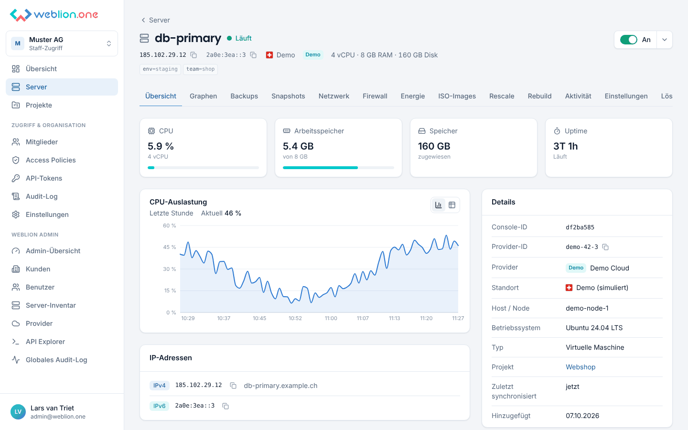
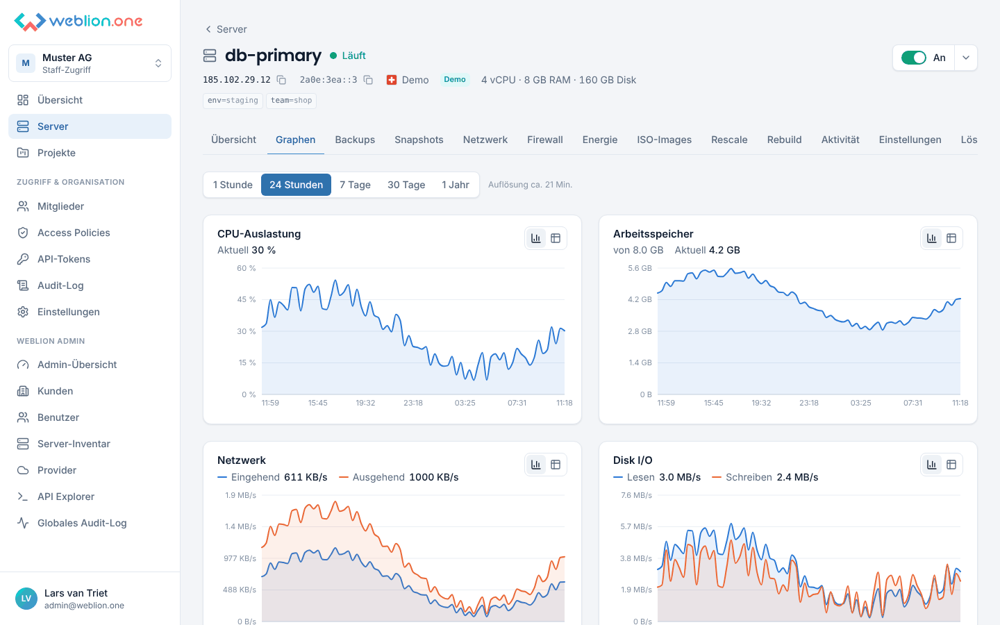
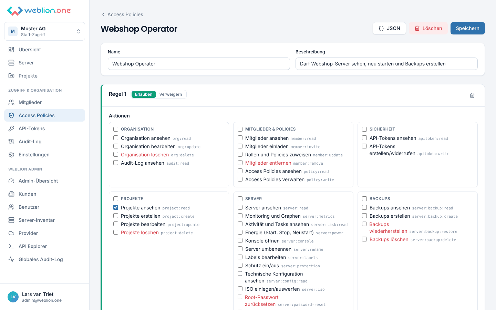
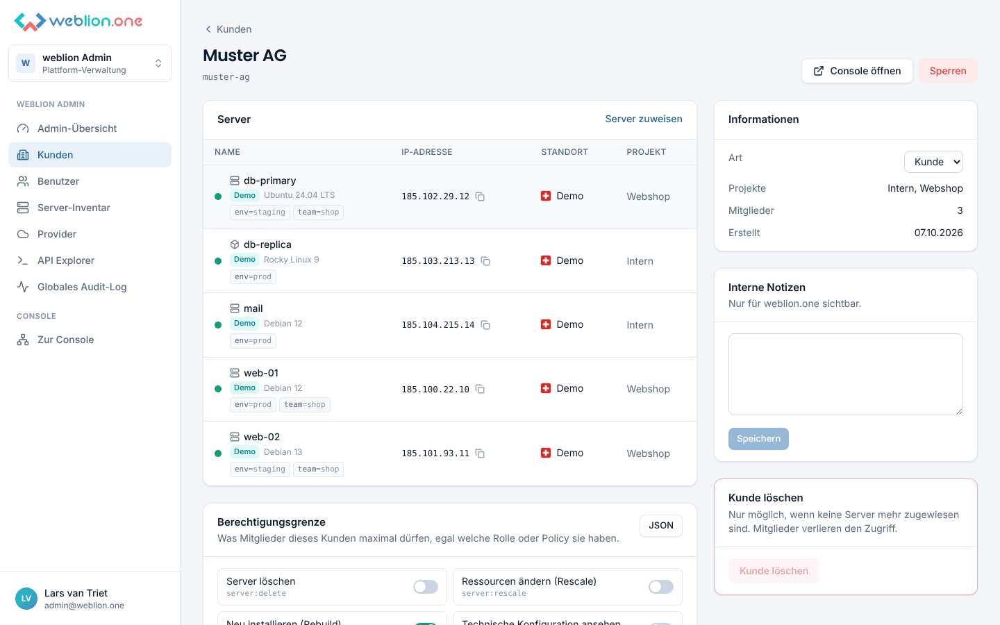
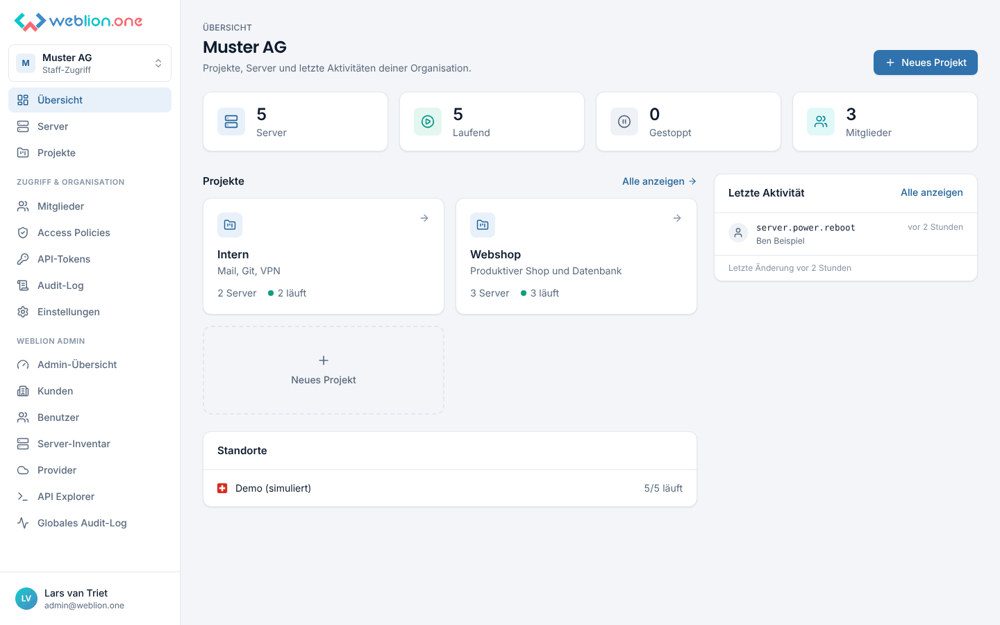
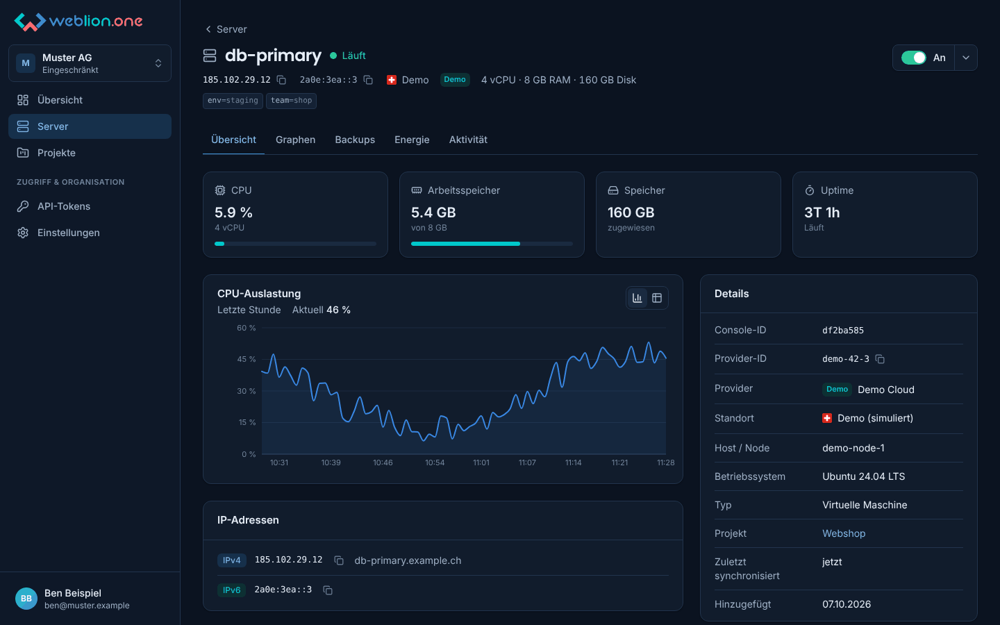
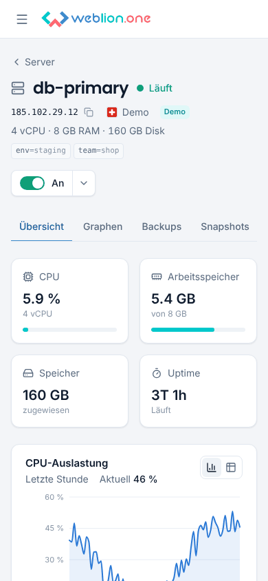
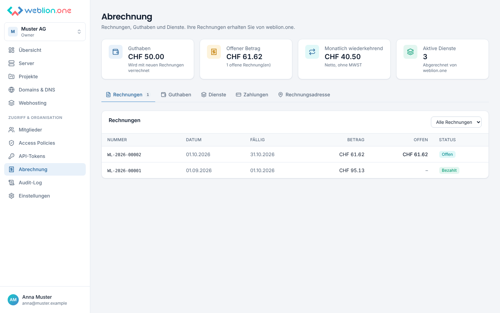
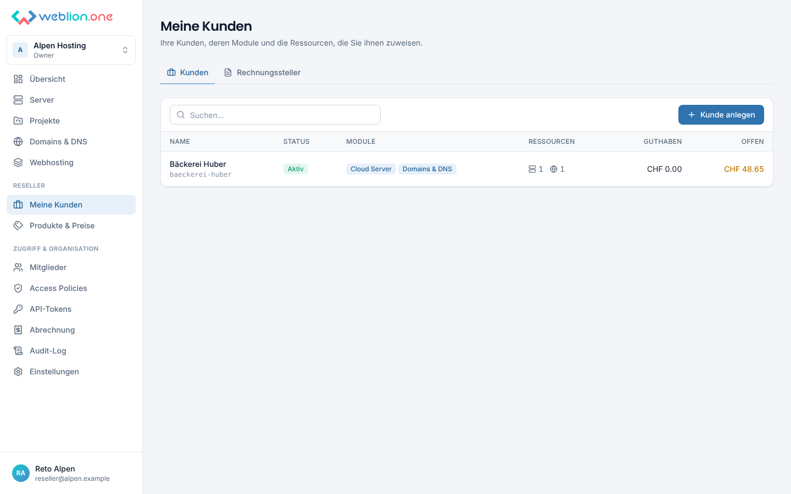
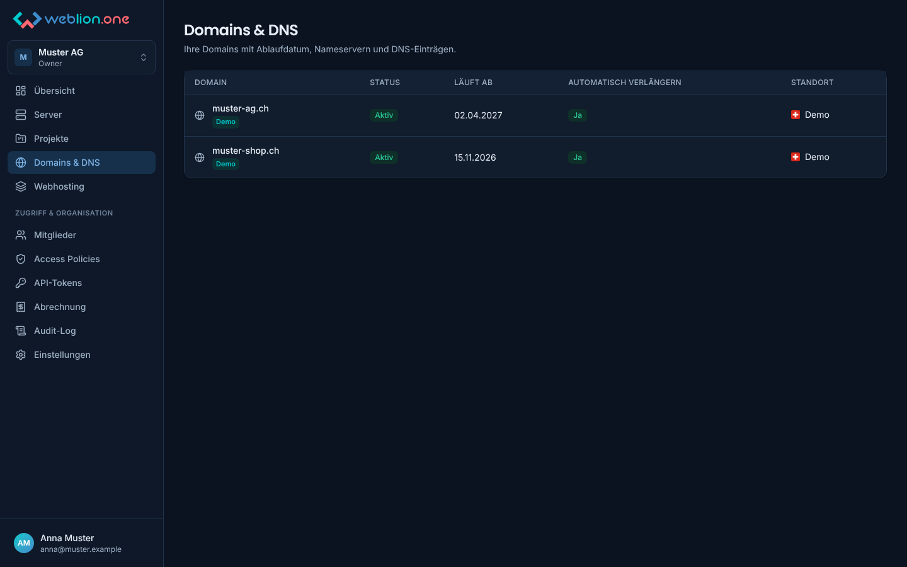

# weblion.one Console

Kunden- und Admin-Panel von weblion.one. Ein Panel für Cloud-Server im Rechenzentrum in
Deutschland (24fire), in der Hetzner Cloud (DE, FI, USA, SG) und auf eigener
Proxmox-Infrastruktur in der Schweiz, dazu Domains mit
DNS, Webhosting, Abrechnung mit QR-Rechnung, Stripe/TWINT und Zoho Books, ein Reseller-Modell
sowie Rollen, Access Policies und Audit-Log. Inspiriert von der Hetzner Cloud Console.



## Was drin ist

**Für Kunden**
- Projekte und Server in einer Übersicht, Standort (Land und Stadt pro Server) und Provider auf
  einen Blick
- Server-Detail mit Tabs: Übersicht, Graphen (CPU, RAM, Netzwerk, Disk I/O, Ping), Backups,
  Snapshots, Netzwerk (rDNS, DDoS), Firewall, Energie, ISO-Images, Rescale (freie Werte oder
  feste Server-Typen wie bei Hetzner), Rebuild, Aktivität, Einstellungen (Name, Labels, Schutz,
  Projekt, Root-Passwort), Löschen. Jeder Tab erscheint nur, wenn der Provider die Funktion
  anbietet
- Browser-Konsole (noVNC) über eine Websocket-Bridge, ohne dass der Browser Provider-Zugangsdaten sieht
- Domains & DNS (24fire): DNS-Einträge bearbeiten, Nameserver, Auth-Code für Transfers
- Webhosting (24fire/Plesk): Ressourcen, Plesk-Zugang, Hinweise für Mail-Programme
- Abrechnung: Rechnungen als PDF mit QR-Rechnung, Guthaben, Dienste, online bezahlen mit
  Karte oder TWINT, Rechnungsadresse
- Nur freigeschaltete Module sind sichtbar (z.B. DNS erst, wenn es aktiviert ist)
- Mitglieder einladen (mit E-Mail), Rollen (Owner, Admin, Member, Eingeschränkt, Nur lesen,
  Buchhaltung)
- Access Policies im IAM-Stil: Aktionen erlauben/verweigern pro Projekt, Server oder Label
- API-Tokens (Lesen / Lesen & Schreiben) für Automatisierung
- Audit-Log, 2FA (TOTP), aktive Sitzungen
- Deutsch und Englisch, helles und dunkles Theme, mobil nutzbar

**Für weblion.one (Admin-Bereich)**
- Plattform-Übersicht mit Provider-Status und fehlgeschlagenen Aktionen
- Kunden und Reseller anlegen (mit Einladung für den Owner), sperren, Module freischalten,
  Berechtigungsgrenze pro Kunde
- Abrechnung: Rechnungen erstellen und abschliessen, Guthaben buchen, Dienste freischalten,
  Produkte und Preise, wiederkehrende Abrechnung, Übersicht über offene und überfällige Beträge
- Domains und Webspaces aus 24fire Kunden zuweisen
- Einstellungen: SMTP, Rechnungssteller (Adresse, IBAN, MWST, Nummernkreis), Status von
  Stripe und Zoho Books, Mail-Log
- Benutzerverwaltung inkl. Plattform-Rollen (Superadmin, Support)
- Server-Inventar: neue Server werden automatisch synchronisiert und Kunden zugewiesen
- Provider verwalten, Verbindung testen, Infrastruktur (Nodes, Storages) ansehen
- Server bei Proxmox aus Templates erstellen, bei Hetzner Cloud mit Server-Typ, Standort und
  Image (Einkaufspreise nur für weblion.one sichtbar)
- API Explorer: Rohzugriff auf die 24fire-, Proxmox- und Hetzner-Cloud-API für alles ohne
  eigenen Button

**Für Reseller**
- Eigene Kunden anlegen und sperren, Module freischalten (bis zum eigenen Umfang)
- Im Panel der Kunden arbeiten, Server, Domains und Webspaces zuteilen
- Eigene Produkte und Preise, Rechnungen mit eigenem Briefkopf und Nummernkreis, Guthaben

| Graphen | Access Policies | Kunde im Admin-Bereich |
|---|---|---|
|  |  |  |
| **Dashboard** | **Dunkel, eingeschränkter Benutzer** | **Mobil** |
|  |  |  |
| **Abrechnung** | **Reseller: eigene Kunden** | **Domains & DNS (dunkel)** |
|  |  |  |

## Stand

- Gegen echte 24fire-, Proxmox-, Hetzner-, Stripe- und Zoho-Systeme ist die Console noch
  **nicht live getestet**: Die Build-Umgebung hatte keinen Netzzugriff darauf. Alle Anbindungen
  sind gegen Mock-Server getestet, die die dokumentierten Antworten nachbilden. Die
  24fire-Endpunkte folgen der offiziellen v2-Doku, die Proxmox-Aufrufe der API-Referenz, die
  Hetzner-Aufrufe der API-Doku und dem offiziellen Go-Client hcloud-go.
- Hetzner Cloud: Firewalls, Volumes, Load Balancer, Floating/Primary IPs, Storage Boxes,
  DNS-Zonen und dedizierte Server (Robot) sind noch nicht angebunden, siehe
  [docs/providers.md](docs/providers.md#hetzner-cloud).
- Webspaces kann die 24fire-API nur lesen: Neue Webspaces werden im 24fire-Panel bestellt und
  erscheinen nach dem nächsten Sync in der Console, wo sie einem Kunden zugewiesen werden.

## Schnellstart (Entwicklung)

Voraussetzungen: Node 22, pnpm 10, Postgres 16.

```bash
pnpm install
cp .env.example .env          # ENCRYPTION_KEY, BOOTSTRAP_ADMIN_* und Provider-Zugangsdaten setzen
pnpm db:migrate
pnpm dev                      # API auf :3000, Web auf :5173
```

Mit Demo-Daten (simulierter Provider, zwei Beispielkunden, ohne echte Server):

```bash
ENABLE_DEMO_PROVIDER=true pnpm db:seed
```

Login danach mit `BOOTSTRAP_ADMIN_EMAIL` / `BOOTSTRAP_ADMIN_PASSWORD` aus der `.env`.
Demo-Benutzer, Passwort `demo-password-123`:

| | |
|---|---|
| `anna@muster.example` | Owner Muster AG (Server, Domains, Webhosting, Rechnungen) |
| `ben@muster.example` | eingeschränkt, nur Webshop-Projekt |
| `carla@muster.example` | nur lesen |
| `reseller@alpen.example` | Owner des Resellers Alpen Hosting |
| `huber@baeckerei.example` | Owner von Bäckerei Huber (Kunde von Alpen Hosting) |

## Zugangsdaten (24fire, Proxmox, Hetzner Cloud)

Zugangsdaten gehören **nicht** ins Git-Repo, auch nicht in ein privates. Sie kommen aus
Umgebungsvariablen (`.env` lokal, Secrets im Deployment) und werden beim Start verschlüsselt
(AES-256-GCM mit `ENCRYPTION_KEY`) in der Datenbank abgelegt:

| Variable | Bedeutung |
|---|---|
| `FIRE24_API_KEY` | Account-API-Key aus dem 24fire Control Panel (in Anführungszeichen, Sonderzeichen) |
| `PROXMOX_URL` | z.B. `https://pve01-zrh.weblion.cloud:2096` |
| `PROXMOX_TOKEN_ID` | `user@realm!tokenid` |
| `PROXMOX_TOKEN_SECRET` | Token-Secret (UUID) |
| `HETZNER_API_TOKEN` | API-Token eines Hetzner-Cloud-Projekts ("Lesen & Schreiben"), eine Verbindung pro Projekt |
| `HETZNER_BASE_URL` | optional, Standard `https://api.hetzner.cloud/v1` |
| `ENCRYPTION_KEY` | `openssl rand -base64 32`, gut aufbewahren |

Weitere Provider (z.B. weitere Hetzner-Projekte) lassen sich im Admin-Bereich hinzufügen.
Details und Hinweise zum Proxmox- und Hetzner-Token in [docs/providers.md](docs/providers.md).

Für E-Mail (SMTP), Stripe/TWINT und Zoho Books kommen weitere Variablen dazu, alle in
`.env.example` beschrieben. SMTP lässt sich statt in der `.env` auch im Admin-Bereich
eintragen (verschlüsselt gespeichert). Einrichtung Schritt für Schritt in
[docs/billing.md](docs/billing.md).

## Produktion

```bash
cp .env.example .env    # NODE_ENV=production, APP_URL=https://cp.weblion.cloud, Secrets setzen
docker compose up -d --build
```

Ein Container liefert API und Web aus, davor ein Reverse Proxy mit TLS. Datenbank ist
PostgreSQL (nicht MySQL). Ein eigener Server ist nicht nötig: Die Console läuft auch auf
einem bestehenden CloudPanel-Server mit, mit oder ohne Docker.
Siehe [docs/deployment.md](docs/deployment.md).

## Projektstruktur

```
apps/api         Fastify API, Postgres (Drizzle), Provider-Adapter, Sync-Job
apps/web         React Console (Vite, Tailwind, TanStack Query)
packages/shared  Berechtigungen, Rollen, Policy-Engine und API-Typen (von beiden genutzt)
docs/            Architektur, Provider, Deployment, Roadmap
```

| Befehl | |
|---|---|
| `pnpm dev` | API und Web im Watch-Modus |
| `pnpm test` | Unit- und Integrationstests (braucht Postgres, `TEST_DATABASE_URL`) |
| `pnpm typecheck` | TypeScript in allen Paketen |
| `pnpm build` | Produktions-Build |
| `pnpm db:generate` | Migration aus Schema-Änderungen erzeugen |

## REST-API

Alles, was die Console kann, geht auch per API unter `/api/v1`, authentifiziert mit einem
API-Token aus der Console:

```bash
curl -H "Authorization: Bearer wlc_…" https://cp.weblion.cloud/api/v1/orgs/<org-id>/servers
curl -X POST -H "Authorization: Bearer wlc_…" -H "Content-Type: application/json" \
  -d '{"action":"reboot"}' https://cp.weblion.cloud/api/v1/servers/<server-id>/power
```

## Weiterlesen

- [docs/architecture.md](docs/architecture.md): Aufbau, Rechte-Modell, neue Provider anbinden
- [docs/billing.md](docs/billing.md): Abrechnung, Reseller, Module, Stripe/TWINT, Zoho Books, E-Mail
- [docs/providers.md](docs/providers.md): 24fire, Proxmox und Hetzner Cloud einrichten, Kosten,
  offene Punkte
- [docs/deployment.md](docs/deployment.md): Betrieb, Backups, Updates
- [docs/roadmap.md](docs/roadmap.md): Ideen für die nächsten Ausbaustufen
